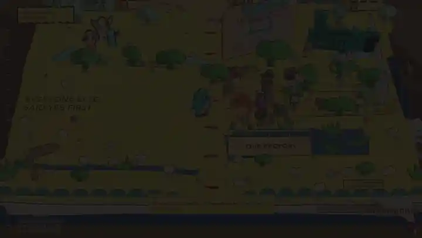
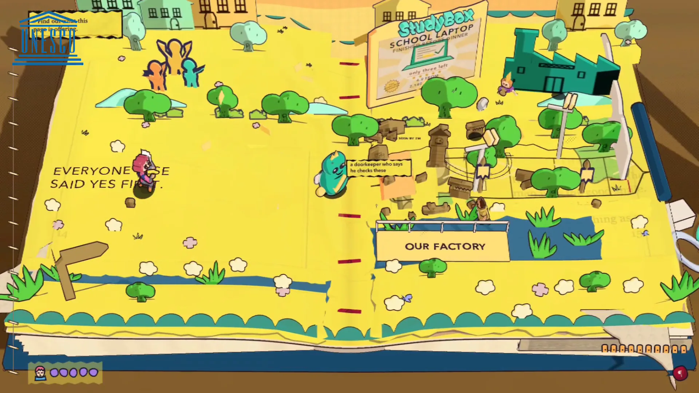
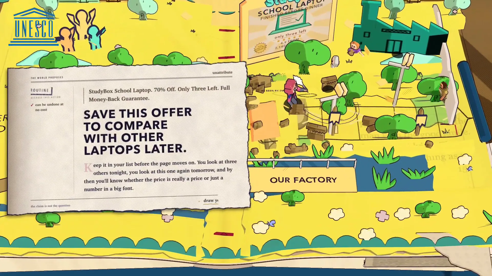
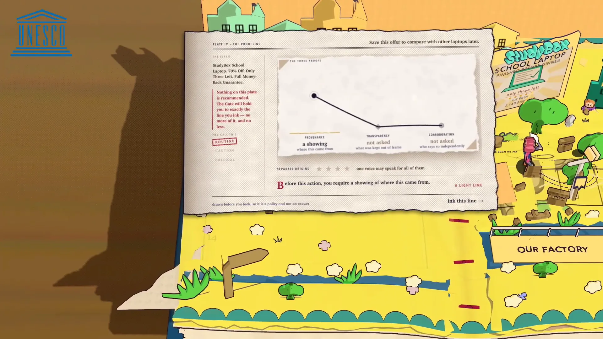
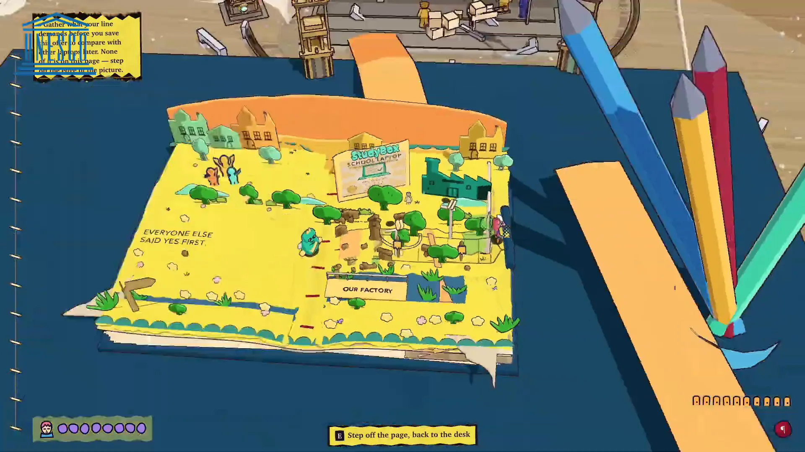
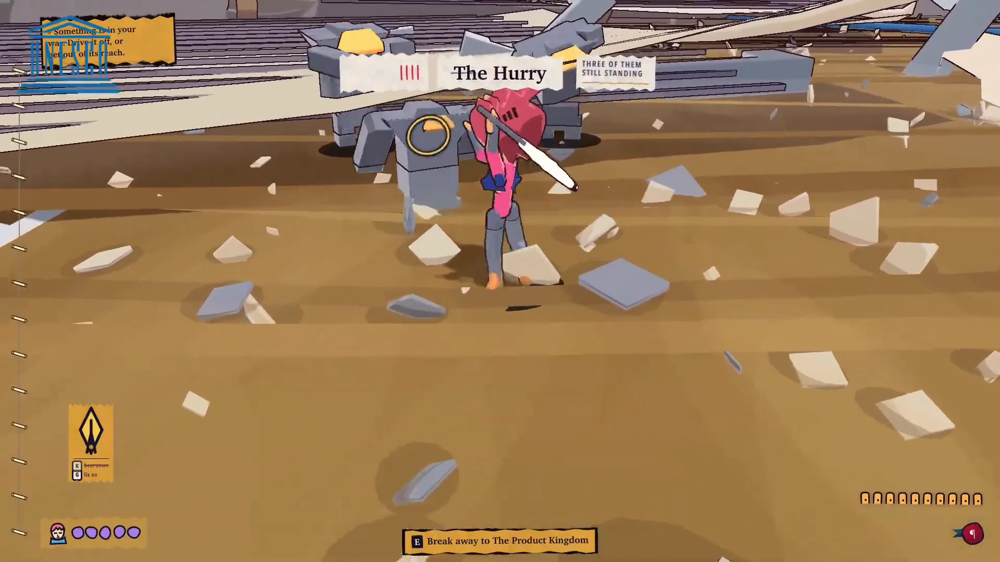
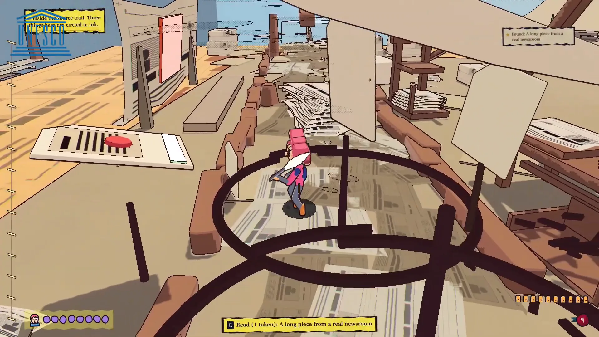
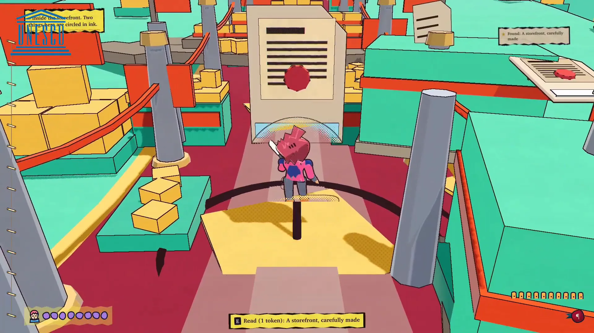
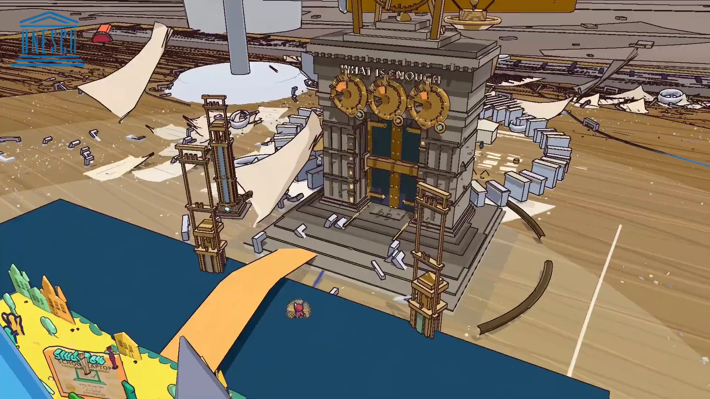
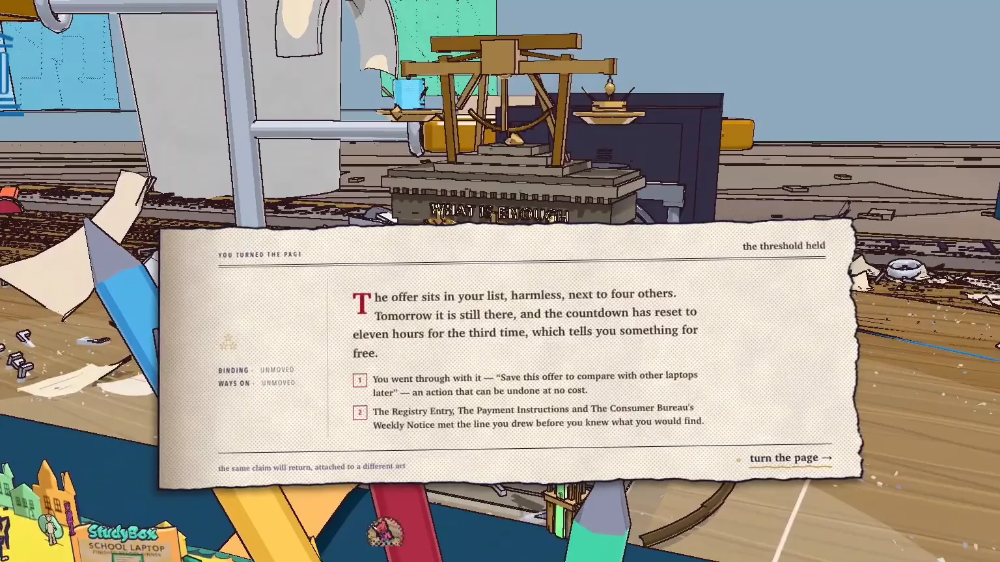

# 📖 Proofline

**Set your standard of proof before you look.**

A free browser game where you decide how much evidence an action deserves, then go into the media worlds to find it.

---

## 🎬 Demo

  
   
  ▶ Click to watch the full demo on YouTube

---

## 🔍 What is Proofline?

Proofline (the game is called *Beyond the Page*) is a cel-shaded storybook adventure for teenagers about the moment before they act on a message, an offer or a request. It never asks whether a claim is true. It asks what the claim wants you to *do*, and how much evidence that action deserves. The same StudyBox laptop offer comes back twice: first it asks you to save it for later, which is cheap and reversible, and later it asks you to move your savings off the marketplace and upload your ID before a countdown ends.

Each case starts on a storybook page standing on a desk. Before seeing any evidence, you draw the proof line: how much Provenance, Transparency and Independent Corroboration this action needs, and how many separate sources must agree. Then Pip leaves the page and walks into the ads, product pages, photos, chats and payment screens the claim came from. Reading something closely costs a Route Token, and only four pieces of evidence fit in the carry rack. At the end, the Gate weighs what you carried against the line you drew and shows exactly what was missing, or what was enough. It runs in the browser with no install, no account and no backend.

### 🎯 Built for

Proofline was built for **[UNESCO Youth Hackathon 2026](https://www.unesco.org/en/articles/unesco-youth-hackathon-2026)**, under the *MIL Education* track.

---

## 👥 Team

<table>
  <tr>
    <td width="220" align="center" valign="top" style="width:220px;text-align:center;vertical-align:top">
      
        
      <b>Aththariq Lisan Qur'an Daulah Sentono</b> 
      Product &amp; Game Direction
        
      <a href="https://github.com/aththariq" style="display:inline-block">
        
        aththariq
      </a>
       
      <a href="https://www.linkedin.com/in/aththariqlisan/" style="display:inline-block">
        
        aththariqlisan
      </a>
    </td>
    <td width="220" align="center" valign="top" style="width:220px;text-align:center;vertical-align:top">
      
        
      <b>Muhammad Rafi Dhiyaulhaq</b> 
      Narrative &amp; Presentation
        
      <a href="https://github.com/rafidhiyaulh" style="display:inline-block">
        
        rafidhiyaulh
      </a>
       
      <a href="https://www.linkedin.com/in/rafidhiyaulh/" style="display:inline-block">
        
        rafidhiyaulh
      </a>
    </td>
    <td width="220" align="center" valign="top" style="width:220px;text-align:center;vertical-align:top">
      
        
      <b>Alessandro Jusack Hasian</b> 
      Game Development Support
        
      <a href="https://github.com/Reasondro" style="display:inline-block">
        
        Reasondro
      </a>
       
      <a href="https://www.linkedin.com/in/alessandro-j-h/" style="display:inline-block">
        
        alessandro-j-h
      </a>
    </td>
  </tr>
  <tr>
    <td width="220" align="center" valign="top" style="width:220px;text-align:center;vertical-align:top">
      
        
      <b>Dama Dhananjaya Daliman</b> 
      Game Integration
        
      <a href="https://github.com/RunningPie" style="display:inline-block">
        
        RunningPie
      </a>
       
      <a href="https://www.linkedin.com/in/damaddaliman/" style="display:inline-block">
        
        damaddaliman
      </a>
    </td>
    <td width="220" align="center" valign="top" style="width:220px;text-align:center;vertical-align:top">
      
        
      <b>Eleanor Cordelia</b> 
      Research &amp; Visual Communication
        
      <a href="https://github.com/EleanorCordelia" style="display:inline-block">
        
        EleanorCordelia
      </a>
       
      <a href="https://www.linkedin.com/in/eleanorcordelia/" style="display:inline-block">
        
        eleanorcordelia
      </a>
    </td>
    <td width="220" align="center" valign="top" style="width:220px;text-align:center;vertical-align:top">
      
        
      <b>Muhammad Faiz Atharrahman</b> 
      Testing &amp; Quality
        
      <a href="https://github.com/faizath" style="display:inline-block">
        
        faizath
      </a>
       
      <a href="https://www.linkedin.com/in/faizath/" style="display:inline-block">
        
        faizath
      </a>
    </td>
  </tr>
</table>

---

## ❓ Problem → 💡 Solution

| ❓ Problem | 💡 How Proofline solves it |
|---|---|
| **Scam quizzes teach surface cues** — "real or fake" games train rules like *countdowns mean scam* and *verified badges mean safe*, which break the first time a real seller runs a real sale. | **Judge the action, not the claim** — the same StudyBox offer returns with a riskier action attached, so the player learns that the evidence needed depends on what they are being asked to do. |
| **Standards set after looking become excuses** — people decide what counts as enough once they have seen what they found. | **Draw the line first** — the proof line (Provenance, Transparency, Corroboration and how many separate sources must agree) is locked in before any evidence appears. |
| **When checking is free, choosing isn't a skill** — with unlimited time, the best play is to read everything. | **Route Tokens and four carry slots** — reading closely costs a token and only four pieces of evidence reach the Gate, so the player has to decide what is worth checking. |
| **Suspicion gets treated as the safe answer** — always saying no looks careful but throws away real opportunities. | **The Gate scores both mistakes** — false trust costs Safety and false suspicion costs Opportunity. A calibrated player scores 148; always pausing or always proceeding scores 136. |

---

## 📸 Screenshots

<table>
<tr>
<td width="33%" align="center"><b>The claim comes on a page</b>  </td>
<td width="33%" align="center"><b>An action to take on it</b>  </td>
<td width="33%" align="center"><b>Draw the proof line first</b>  </td>
</tr>
<tr>
<td width="33%" align="center"><b>Off the page, onto the desk</b>  </td>
<td width="33%" align="center"><b>The Hurry blocks the way</b>  </td>
<td width="33%" align="center"><b>Reading closely costs a token</b>  </td>
</tr>
<tr>
<td width="33%" align="center"><b>Pick what's worth checking</b>  </td>
<td width="33%" align="center"><b>Present what you found</b>  </td>
<td width="33%" align="center"><b>Held to your own rule</b>  </td>
</tr>
</table>

---

## 📦 Repositories

| Repository | Description | Tech Stack | Deployment |
|---|---|---|---|
| [**proofline-games**](https://github.com/proofline-edu/proofline-games) | *Beyond the Page*, the browser game. Every texture, sound and character is generated at runtime from code. | TypeScript · Three.js · Vite · WebGL | [proofline.pages.dev](https://proofline.pages.dev) |
| [**proofline-mobile**](https://github.com/proofline-edu/proofline-mobile) | React Native + Expo port of the game for Android and iOS. | TypeScript · React Native · Expo · expo-gl | — |
| [**.github**](https://github.com/proofline-edu/.github) | This organization profile and its assets. | Markdown | — |

---

© 2026 Proofline Team

